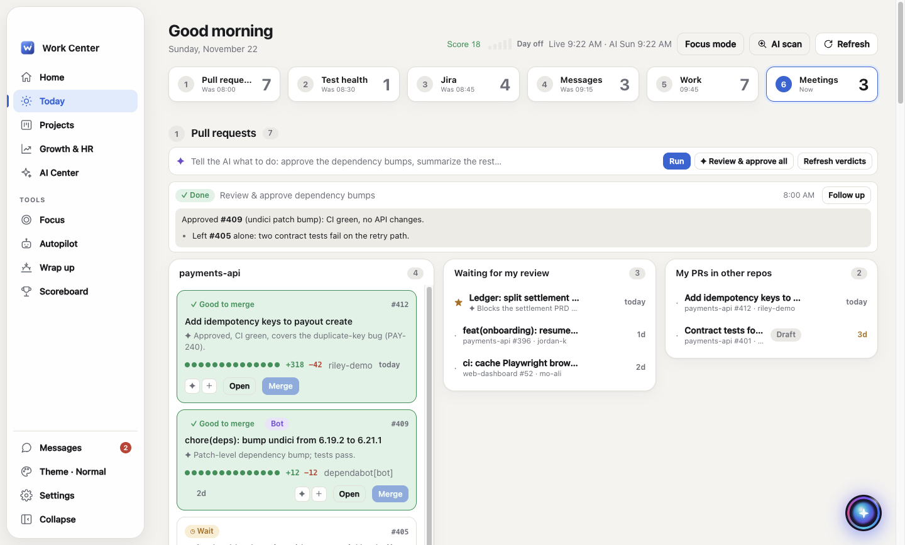
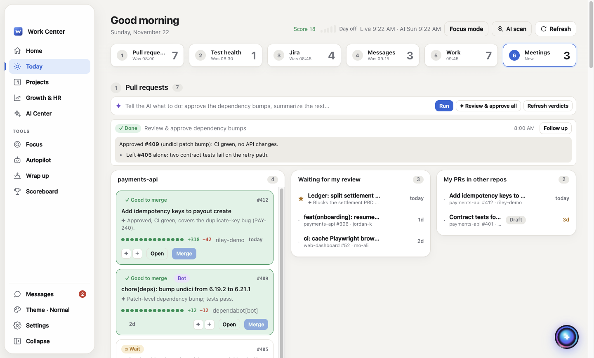
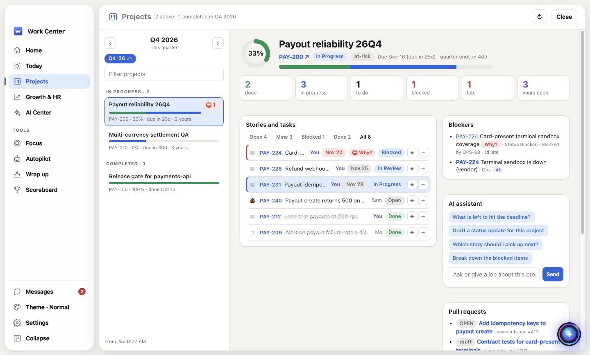
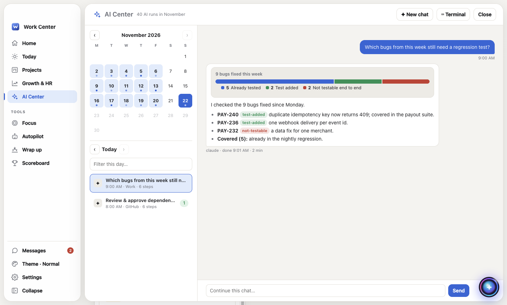
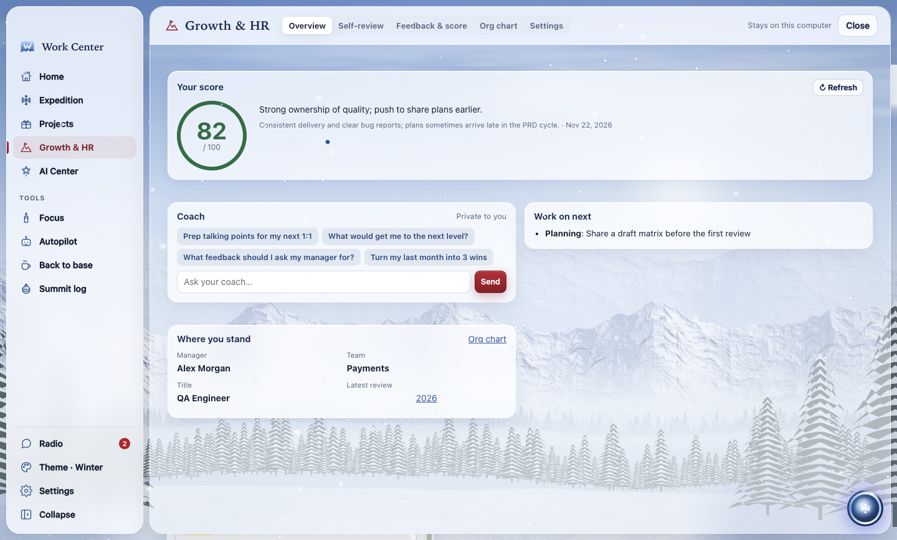
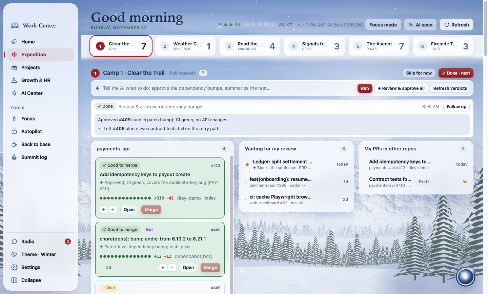
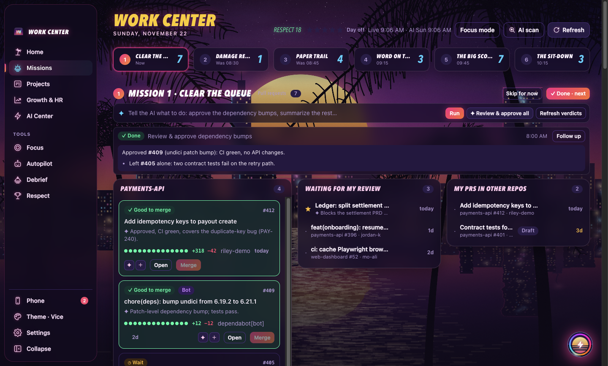
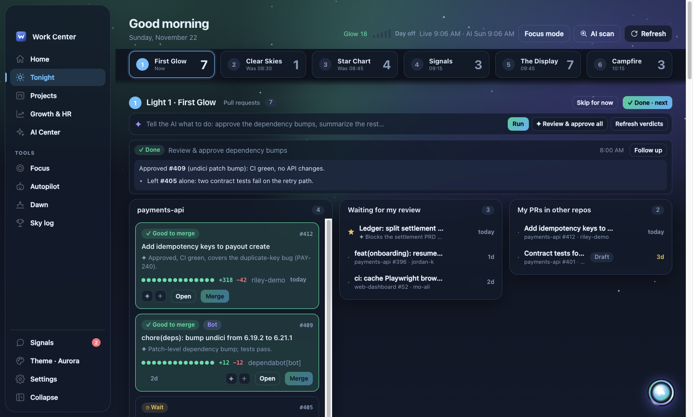

# Work Center

**Your workday on one screen, with an AI that already knows your tools.**

Work Center is a desktop app that turns the morning tab shuffle into a short, guided run through what needs you:
pull requests, tickets, messages, meetings and the next steps on your own work. It uses the AI assistant and the
logins you already have on your computer, so there is nothing new to sign up for and no data leaves your machine
except through the tools you already use.



<sub>All screenshots use the built-in demo data (`npm run demo`): a made-up person at a made-up company.</sub>

## The problem

A typical morning goes like this: open GitHub to see which PRs need you, then Jira for the sprint and your bugs,
then Slack for who asked what overnight, then the calendar, then try to remember what you were in the middle of.
Every tool shows its own slice, none of them knows what matters to *you* today, and by the time you have a picture,
half an hour is gone. Then the day keeps interrupting with the same loop.

AI assistants help, but only once you've explained the situation to them, every time.

## How Work Center solves it

- **One page, in order.** The day is a short flow of steps (pull requests → test health → Jira → messages → your
  work → meetings). The current step is open, the rest are folded. Finish one, press **Done · next**.
- **The AI already has the context.** A morning scan reads your PRs, sprint, bugs, Slack threads and meetings and
  writes verdicts ("good to merge", "wait: two tests fail"), reply drafts, meeting prep, a standup, the next steps
  on each of your stories and tests worth adding.
- **Act from where you are.** Every section has an AI bar: "approve the dependency bumps", "draft replies for
  #payments-qa", "break this story down". Point the AI at any card with ✦, or right-click → **Ask AI**. Anything that
  acts outside the app (approve, merge, comment, send) asks first.
- **See the bigger picture.** Projects built from your Jira epics, a Growth & HR view that writes your self-review
  from the work you actually did, and an AI Center with every run by day.

| | |
|---|---|
|  |  |
| **Your work:** AI replies with charts, your tasks, next steps on each story, tests worth adding | **Projects:** every epic with progress, deadlines, blockers (hover **Why?**), PRs and an AI brief |
|  |  |
| **AI Center:** every AI run by day, with full transcripts | **Growth & HR:** feedback score, coach, org chart and a self-review written from your work |

## Why it's good

- **Minimal setup.** No accounts, no API keys, no server. It finds the AI tools already on your machine (Claude
  Code, Cursor, Gemini CLI, Codex…), reads the connections you set up for them (MCP servers, rule files like
  `CLAUDE.md`) and the CLIs you're logged into (`gh` for GitHub, `twg` for Jira). **Set me up** fills in your
  profile for you.
- **Local and private.** Everything it writes stays in a folder on your computer (`~/.daily-hq`). Nothing is posted
  anywhere unless you press the button that says so.
- **Your AI, your rules.** It runs the AI engine you already pay for, with your own instruction files, and keeps a
  notes file of corrections you give it ("Thomas left the company") that every later run reads.
- **Pleasant to use every day.** Themes (Normal, Winter, Vice, and ones anyone can [make and share](THEMES.md)),
  an AI orb that is always one click away, a phone-style Messages panel, focus sessions and a wrap-up at the end of the day.



## Get started

You need Node 20+ and, for the AI parts, one AI coding CLI that's logged in (Claude Code works best).

```bash
git clone https://github.com/sslugic/work-center.git
cd work-center
npm install
npm start
```

Open **Settings → Set me up**. It detects your AI tool, GitHub and Jira logins and fills in your profile. Then press
**✦ AI scan** once; after that it runs on its own every morning.

Other ways to run it:

```bash
npm run demo        # try it on made-up data, nothing connected
npm run web         # the same page in your browser, no Electron
npm run dist:mac    # build Work Center.app (copy it to ~/Applications)
```

| Connection | What it adds | How |
|---|---|---|
| An AI CLI (Claude Code, Cursor Agent, Gemini CLI, Codex) | the scan, every AI action, chats | already installed and logged in |
| GitHub | PRs, reviews, CI health | `gh auth login` |
| Jira | sprint, bugs, PRDs, projects | the `twg` CLI, logged in |
| Slack, calendar, email, meeting notes | messages that need you, meeting prep | whatever your AI tool is connected to (MCP or account connectors) |
| Spotify (optional) | a **Music** panel: now playing and your recent playlists, one click to play | open **Music** in the sidebar and follow the three steps (your own free Spotify developer app; no secret) |

Missing a connection? That part of the page says so and the rest keeps working.

## Themes

Pick one from **Theme** in the sidebar. Anyone can build a theme without code: colors, wallpaper, icons, wording and a
background effect, packed as a folder or .zip. See [THEMES.md](THEMES.md); you can also hand
[docs/THEME-AI.md](docs/THEME-AI.md) to your AI and describe the theme you want.

| | |
|---|---|
|  |  |

## Help build it

Work Center started as one engineer's morning routine, so today it fits engineering and QA best. The big next step
is **role packs**: sections for managers, sales, customer support, product, HR and more. See [ROADMAP.md](ROADMAP.md)
for the plan and the open issues for pieces you can pick up. New sections plug in as files, without touching the core:
[docs/FEATURES.md](docs/FEATURES.md) explains how.

- [docs/REFERENCE.md](docs/REFERENCE.md): everything the app does, section by section
- [docs/FEATURES.md](docs/FEATURES.md): writing a feature or a new section
- [THEMES.md](THEMES.md): making a theme
- `npm run demo` and `npm run screenshots`: try changes on made-up data and refresh these screenshots

## License

[MIT](LICENSE)
